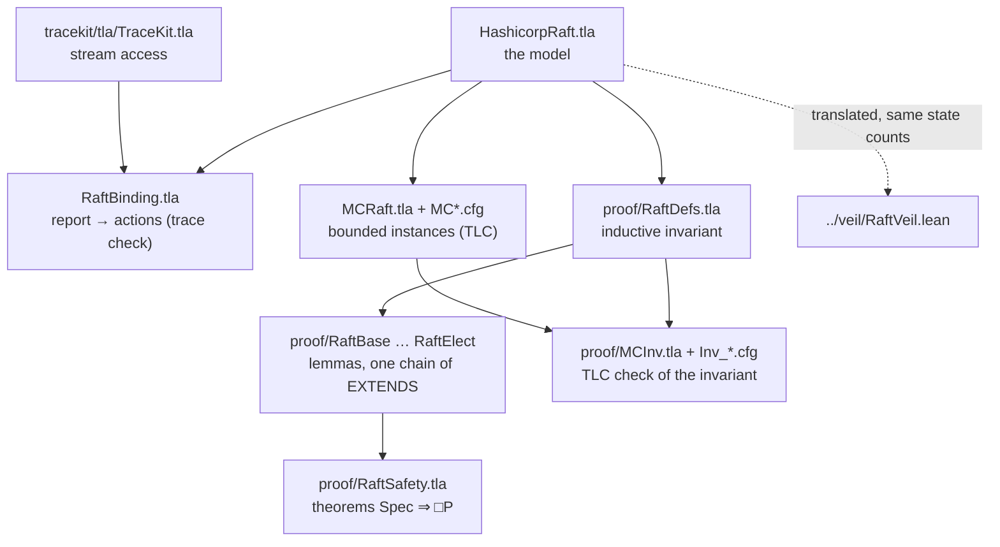

# The model of hashicorp/raft

[`HashicorpRaft.tla`](HashicorpRaft.tla) is a model of hashicorp/raft with the five patches of
[`../patches/README.md`](../patches/README.md) applied. It is small-step: one action per durable write, message
sent, reply and role change, so that each step a node reports in a test run is one or a few
model actions. Messages are facts in a set that only grows: a request can be acted on at
any later time, any number of times, which covers delay, loss, duplication and
reordering.

## What is modelled

| Feature | Modelled | Notes |
|---|---|---|
| Leader election, voting, terms | ✅ | A vote is two durable writes (`SetVoteFor`, then `SetVoteTerm`), as raft makes them with patch R2 |
| Log replication, conflict deletion | ✅ | `SendAppend` sends any segment of the term's leader log (`ledLog`), at any time |
| Commitment and application to the state machine | ✅ | Which entry each node hands its state machine at each index; not the state machine's contents |
| Crash and restart | ✅ | `Restart` keeps the durable variables and resets the rest |
| Pre-votes | ✅ | Constant `PreVote` (raft's `PreVoteDisabled`); proofs hold for both values |
| Leadership transfer (`TimeoutNow`) | ✅ | As raft does it: no term on the request, obeyed in any role |
| Snapshots: take, compact, send, install | ✅ | Constant `Snapshots`; proofs hold for both values. A snapshot is the prefix of the log it covers; installing one is an append request that starts at index 1 |
| Membership changes | ❌ | The cluster is a fixed set of voters |
| Heartbeat fast path (`processHeartbeat` on the transport goroutine) | ❌ | Disabled in the harness; it races the main loop ([`../patches/README.md`](../patches/README.md)) |
| Liveness | ❌ | Safety only |

## Safety properties

Defined at the end of [`HashicorpRaft.tla`](HashicorpRaft.tla). Proved means: for any finite set of servers, any
number of terms and entries, and both values of `PreVote` and `Snapshots`.

| Property | Statement | TLAPS | Lean |
|---|---|---|---|
| `ElectionSafety` | At most one server is elected in a term | ✅ | ✅ |
| `LogMatching` | Two logs with an entry of the same term at an index agree up to that index | ✅ | ✅ |
| `CommitSafety` | Two committed prefixes never disagree | ✅ | ✅ |
| `StateMachineSafety` | No two state machines are handed different entries at one index | ✅ | ✅ |
| `LeaderCompleteness` | A leader's log holds every prefix committed in an earlier term | ✅ | ✅ |
| `OneVotePerTerm` | A node never votes for two candidates in one term | ✅ (conjunct of the inductive invariant) | ✅ |
| `CommittedEntriesPreserved` | A server keeps every prefix it committed | – | ✅ |
| `LeaderLogIsLed`, `RequestsFromLed`, `ConfirmedWithinLog` | The model's bookkeeping (`ledLog`, `confirmed`) is consistent | – | ✅ |
| `SnapshotWithinLog`, `BaseWithinSnapshot`, `SnapshotCommitted`, `SnapshotApplied` | A snapshot is a committed prefix of its node's log; compaction deletes only what it covers; a state machine is never behind its snapshot | – | ✅ |
| `PreVoteRequestsBounded`, `PreGrantsAnswer`, `TimeoutNowFromLeader`, `TransferIsCandidate` | Pre-vote and transfer facts are well formed | – | ✅ |
| `TermMonotonic`, `NoAppliesSkipped`, `AppliedMonotonic`, `ElectionsLicensed` | Properties of steps (not state invariants) | – | – |

The step properties, and `AcceptsAfterSnapshot` and `SnapshotAgreesApplied` (which follow
from the proved invariants), are checked by TLC on the bounded instances.

## Files

| File | Role |
|---|---|
| [`HashicorpRaft.tla`](HashicorpRaft.tla) | The model: `Init`, `Next`, `Spec`, the properties |
| [`RaftBinding.tla`](RaftBinding.tla) | Trace spec: reads the stream of reports (`TraceKit.StreamEvent`) and maps each to model actions; configurations [`RaftBinding*.cfg`](./) (3 or 5 nodes, with or without pre-votes); [`manifest.json`](manifest.json) tells [`tracekit/check/streamcheck.py`](../tracekit/check/streamcheck.py) which to use |
| [`MCRaft.tla`](MCRaft.tla) | Bounds (`MaxTerm`, `MaxLog`, `MaxBatch`, `MaxMsgs`), symmetry, and three restricted next-state relations for TLC |
| [`MC*.cfg`](./) | Bounded instances, below |
| [`proof/`](proof/) | TLAPS proofs ([`proof/README.md`](proof/README.md)); [`proof/spec.sha256`](proof/spec.sha256) pins the spec files they are about |

## Bounded instances (TLC)

All three servers, one client value. `Count` instances use the unrestricted `Spec` with no
symmetry, for comparison with Veil's model checker ([`../veil/README.md`](../veil/README.md)).

| Config | Spec | Bounds (terms, log, batch, messages) | Distinct states |
|---|---|---|---|
| [`MCCount2.cfg`](MCCount2.cfg) / [`MCCount3.cfg`](MCCount3.cfg) / [`MCCount4.cfg`](MCCount4.cfg) | `Spec` | 2, 2, 1, 2/3/4 | 6,488 / 30,880 / 202,840 |
| [`MCCountPV4.cfg`](MCCountPV4.cfg) / [`MCCountPV5.cfg`](MCCountPV5.cfg) | `Spec`, `PreVote` | 2, 2, 1, 4/5 | 17,704 / 113,968 |
| [`MCCountSnap4.cfg`](MCCountSnap4.cfg) | `Spec`, `Snapshots` | 2, 2, 1, 4 | 227,032 |
| [`MCTiny5.cfg`](MCTiny5.cfg) | `QuietSpec` (no restarts) | 2, 2, 1, 5 | 72,484 |
| [`MCTiny5PV.cfg`](MCTiny5PV.cfg) | `QuietPVSpec` (pre-votes, transfer) | 2, 2, 1, 7 | 525,823 |
| [`MCSnap.cfg`](MCSnap.cfg) | `QuietSpec`, `Snapshots` | 2, 3, 1, 5 | 1,672,432 |
| [`MCFullTiny5.cfg`](MCFullTiny5.cfg) | `FullSpec` (every action) | 2, 2, 1, 5 | 413,620 |
| [`MCFullTiny5PV.cfg`](MCFullTiny5PV.cfg) | `FullSpec`, `PreVote` | 2, 2, 1, 6 | 114,766 |
| [`MCFullSnap.cfg`](MCFullSnap.cfg) | `FullSpec`, `Snapshots` | 2, 3, 1, 4 | 142,735 |

Every instance completes with no violation of the properties it lists.

## Trace validation

Each node reports its steps from wrappers around the interfaces raft is given
([`../server/wrap.go`](../server/wrap.go)): the stable store, the log store, the transport, the state machine
and the observer. Durable writes are announced before they are made, so after a crash at most
the last announced write is uncertain; `Restart` resolves it from the state the node
recovers. The driver merges the reports into one stream; TLC follows the stream as it is
written, one model state per report, with no search.

| Report | Model actions |
|---|---|
| `stable.set CurrentTerm` | `StartElection` (candidate, next term; requires a pre-vote quorum or a `TimeoutNow` when `PreVote`) or `AdoptTerm` |
| `stable.set LastVoteCand` / `LastVoteTerm` | `SetVoteFor` / `SetVoteTerm` |
| `log.store`, `log.delete` | `LeaderAppend` or `StoreEntries`; `DeleteSuffix` or `CompactLog` |
| `role` | `BecomeCandidate`, `BecomeFollower`, `BecomeLeader`; `TimeoutNow` |
| `rpc.send` append / heartbeat / prevote / timeoutnow | `LeaderCommit` if needed, then `SendAppend`; `SendPreVote`; `SendTimeoutNow` |
| `rpc.reply` | `GrantVote`, `GrantPreVote`, or `Ack` then `FollowerCommit` |
| `snap.store` | `TakeSnapshot` or `InstallSnapshot` |
| `fsm.apply` | `Apply` for each index up to the reported one (commands only are reported) |
| `boot` | `Restart` |

At every step the trace spec checks `ElectionSafety`, `OneVotePerTerm` and `Safe`, which
covers `CommitSafety`, `StateMachineSafety`, `LeaderCompleteness`, `LogMatching`,
`CommittedEntriesPreserved`, `TermMonotonic` and the follower commit bound (below), evaluated
on a summary of the model's history. A run fails at the first report the model cannot take (`REJECTED k`) or the first
state that violates a property (`VIOLATED k`). [`../scripts/validator-tests.sh`](../scripts/validator-tests.sh) checks the
check: recorded streams in [`../traces/`](../traces/) are accepted and each of 29 mutations of them is
rejected at the mutated event or the first one that depends on it.

The driver adds checks on what clients and the nodes' logs show: one leader per term,
identical applied histories, acknowledged writes survive, linearizable reads see every
acknowledged write, terms never decrease, no committed entry is truncated, and fault-only
code paths (election timeout, lease loss, log mismatch, vote and pre-vote refusals, a
`TimeoutNow` that deposes a leader) are reached.

## Assumptions and limitations

What the proofs assume:

- `Server` is finite (`ASSUME ServerFinite`). Nothing else: any number of servers, terms
  and entries, either value of `PreVote` and `Snapshots`.
- The proofs are about the model. That raft follows it is established by the trace check,
  on the behaviours the runs reach.

What the trace check takes on trust:

- **The wrappers report what raft does**, in order, before it happens: writes are announced
  before they are made, replies are reported before they leave. The wrappers sit outside
  raft ([`../server/wrap.go`](../server/wrap.go)) and the order follows from raft calling them.
- **Storage.** BoltDB commits each write as a transaction: after a crash a write is either
  there or not, and completed writes keep their order. Antithesis crashes processes; it
  does not corrupt or lose synced data.
- **Reports from one node arrive in order and none is lost** (one socket per node; a gap in a
  node's sequence numbers stops the check with an error).
- **The trace spec.** [`RaftBinding.tla`](RaftBinding.tla) extends the model and uses its actions where a
  report is one action. Where a report is several (`rpc.send`, `rpc.reply`), or has no
  action of its own (restart after an unmade write, forgetting old messages), the step is
  written out by hand, and the summary that `Safe` is evaluated on replaces the model's
  `commits` and `applied`. That each such step is a sequence of model steps, and that `Safe`
  implies the model's properties, is argued, not checked;
  [`validator-tests.sh`](../scripts/validator-tests.sh) tests it on samples.

Where the model allows more than raft does (so the proofs cover raft):

- A request can be sent at any time after the state it was built from; a request is a
  segment of its term's leader log with a commit index committed in that term or earlier.
- A `TimeoutNow` may go to a target that is behind; a node may grant a pre-vote while it
  knows of a leader; a leader does not refuse writes during a transfer; a candidate keeps
  its `TimeoutNow` licence until it starts an election or leaves the role.
- A follower may commit up to what any request of the leader's term has confirmed of its
  log (`confirmed`); raft, with patch R5, commits up to the last entry of the request it is
  handling. A reported commit past `confirmed` is the violation `CommitBeyondConfirmed`.

Not covered:

- Membership changes, raft's `Restore` API, log stores that cannot delete from the front,
  the heartbeat fast path, liveness, the state machine's contents (the driver checks the
  sums clients see).
- Three or five voters in the test cluster; the proofs are for any finite number.
- A TLC behaviour holds at most 65,535 states, so the driver ends a timeline at 55,000
  reports.
- Of the five faults, R3 and R4 have been observed in test runs of unpatched raft, and R5
  has a reproducer that drives one follower. R1 (which needs five nodes) and R2 are argued
  from the code; no run has reproduced them ([`../patches/README.md`](../patches/README.md)).
